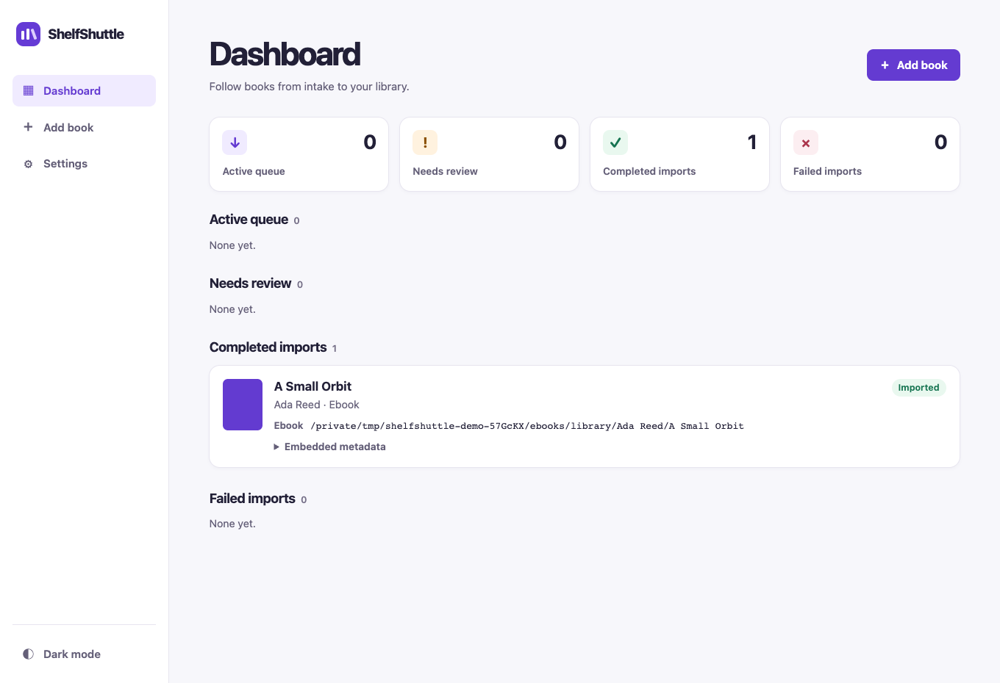
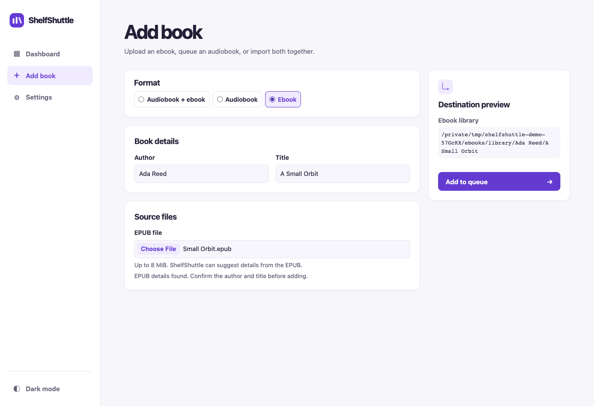

# ShelfShuttle

**From download to bookshelf, without the busywork.**

ShelfShuttle is a self-hosted ebook and audiobook intake manager. Upload an EPUB, track a download in your existing qBittorrent instance, and deliver the finished files to Audiobookshelf or another library manager that reads directories.

## Features

- Add an ebook, an audiobook, or a paired edition. ShelfShuttle suggests author and title from the EPUB and previews folders using the names you confirm.
- Start downloads with a BitTorrent v1 magnet or info hash and track actual qBittorrent progress through restarts.
- Import EPUBs and single M4Bs as `Author - Title`. MP3s keep their original filenames and disc structure. A paired edition puts the EPUB beside the audio in one audiobook library folder.
- Review mismatched tags, existing destinations, and duplicate torrents. Retry failed jobs from the dashboard.
- Validate sources in dry-run mode. Imports stage copies in private directories on the destination mount and use an atomic rename or exclusive file copies to protect existing files.
- Run with reverse-proxy authentication, responsive light and dark themes, and non-root Docker defaults.

Use torrents for content you have permission to download and share. ShelfShuttle accepts sources you provide and has no catalog or acquisition integrations.

## Screenshots

The dashboard and Add Book form with a generated EPUB in a temporary library.





## Install with Docker Compose

ShelfShuttle delegates UI and API authentication to your reverse proxy. Configure authentication on every route to the service over HTTPS before exposing it. The default Compose service has no published host port.

Save [docker-compose.yaml](docker-compose.yaml) on your server. It runs one service from the published [ShelfShuttle image](https://github.com/harshbaldwa/shelfshuttle/pkgs/container/shelfshuttle). Set the values in that file or pass them in from your shell. Compose needs no `.env` file, source checkout, or local build.

1. Attach the service to the trusted network shared by your reverse proxy. The example uses the existing external `frontend` network.
2. Set `PUID` and `PGID` to the host user and group that can read downloads and write to your intake and library directories.
3. Set the host-side volume paths and the qBittorrent URL and remote download root. Mount downloads read-only.
4. Enable the example Traefik labels with your hostname and authentication middleware, or point your existing authenticated router at `shelfshuttle:8080`.

```sh
docker compose pull
docker compose up -d --wait
```

| Container path | Purpose |
| --- | --- |
| `/app/data` | Durable state. The image prepares the `./data` bind automatically. |
| `/app/intake` | Uploaded EPUBs pending processing. |
| `/downloads` | Files downloaded by qBittorrent. |
| `/media/books/books` | Ebook-only imports. |
| `/media/books/audiobooks` | Audiobook-only and paired imports. |

ShelfShuttle creates a private `.shelfshuttle` directory inside each library mount for staging. Exclude this hidden directory if your library manager scans dot-directories. No library or staging variables are needed for the mounts above.

Set the qBittorrent download root to the path the client sees for this category. ShelfShuttle maps that path to `/downloads`. Save any qBittorrent credentials in Settings, or use the environment or a mounted secret file. Run **Test saved connection** from Settings to check access. [Configuration reference](docs/configuration.md)

When upgrading, keep the same state mount to retain your queue and settings. Finish any already-prepared imports before changing their library or staging mount paths. [State storage and upgrades](docs/configuration.md#state-storage)

## Local development

Use Python 3.12 or newer on Linux or macOS. The commands below keep all files under an ignored, disposable directory in the checkout.

```sh
python3.12 -m venv .venv
. .venv/bin/activate
python -m pip install -e '.[dev]'
mkdir -p .local/downloads
export SHELFSHUTTLE_DATA="$PWD/.local/state"
export SHELFSHUTTLE_INTAKE_MOUNT="$PWD/.local/intake"
export SHELFSHUTTLE_DOWNLOADS_MOUNT="$PWD/.local/downloads"
export SHELFSHUTTLE_AUDIOBOOK_MOUNT="$PWD/.local/audiobooks"
export SHELFSHUTTLE_EBOOK_MOUNT="$PWD/.local/ebooks"
export SHELFSHUTTLE_COOKIE_SECURE=false
uvicorn app.main:app --host 127.0.0.1 --port 8080 --no-access-log
```

```sh
ruff check .
ruff format --check .
pytest
```

Tests generate synthetic content in temporary directories and use mocked qBittorrent responses. They require no media services, library files, or container daemon.

## Documentation

- [Configuration, deployment, and API](docs/configuration.md)
- [Architecture and recovery model](docs/architecture.md)
- [Troubleshooting](docs/troubleshooting.md)
- [Contributing](CONTRIBUTING.md)
- [Security reporting](SECURITY.md)
- [MIT license](LICENSE)

## Current scope

This release targets a single deployment using local SQLite storage. Each user admitted by the proxy can manage the app. It ships an embedded metadata provider and an interface for future providers. The intake worker accepts BitTorrent v1 magnets and hashes, one EPUB per job, and either one M4B or a set of MP3s. Imports use copies to preserve seeding. Disk capacity and supported filesystem semantics determine whether atomic import is available.
